<h1 data-importer="text" align="center">Heya</h1>

I’m Junior. I’ve been interested in computers ever since I was a kid, which led me to go to college for Computer Science and start a career in Web Development.

More recently, I’ve been pivoting to DevOps. I’m maintaining a Kubernetes Homelab to learn more about the field and improve my skills.

In my free time, I like to make art, exercise, try out new hobbies and hangout with friends.

My account has many repositories due to coursework I’ve done over the years, but my most important repos are pinned.

<a href="mailto:junior-enio@outlook.com">If you'd like to, send me an email</a>

<picture data-importer="pacman">
  <source media="(prefers-color-scheme: dark)" srcset="https://raw.githubusercontent.com/enjunior-git/enjunior-git/pacman-output/bomberman-contribution-graph-dark.svg?game=bomberman">
  <source media="(prefers-color-scheme: light)" srcset="https://raw.githubusercontent.com/enjunior-git/enjunior-git/pacman-output/bomberman-contribution-graph.svg?game=bomberman">
  
</picture>

<h2>Career</h2>

Professionally, I’ve worked for about 7 years in medium-small scale applications. I started in FrontEnd with HTML, CSS, Javascript, jQuery and Bootstrap. I’ve also done a little bit of PHP at the time, back when we deployed websites with FileZilla.

I later moved into Full-Stack development with Typescript, Next.js and React.

  
  

I’ve also had my fair share of experience with LLMs for coding. Though I prefer to use restrictively for personal projects, assume that my repositories include some kind of AI usage, be it for research and debugging up until AI-assisted coding in my IDE for chores and non-important projects. <a href="https://enjunior.ca/posts/2026/on-generative-ai/" rel="noreferrer noopener" target="_blank">You can read my current stance on Generative AI here if that interests you</a>. To keep it short, I believe AI should stay away from creative endeavours, and its usage in tech needs to be more thoughtful and not replace the problem-solving and creative process that professionals have been using for decades.

<h2>Skills</h2>

Those are technologies I’ve touched over the years. Most were ones that I experimented with here and there. Silly to have that many listed, I know, but it’s fun to look back and see how many things you’ve dabbled in.

    
Technologies & Tools

    

      
      
      
      
      
      
      
      
      
      
      
      
      
      
      
      
      
      
      
      
      
      
      
      
      
      
      
      
      
      
      
      
      
      
      
      
      
      
      
      
      
      
      
      
      
      
      
      
      
      
      
      
      
      
      
      
      
      
      
      
      
      
      
      
      
      
      
      
      
      
      
      
      
      
      
      
      
      
      
      
      
      
      
      
      
      
      
      
      
      
      
      
      
      
      
      
      
      
      
      
      
      
      
      
      
      
      
      
      
      
      
      
      
      
      
      
      
      
      
      
      
      
      
      
      
      
      
      
      
      
      
      
      
      
      
      
      
      
      
      
      
      
      
      
      
      
      
      
      
      
      
      
      
      
      
      
      
      
      
      
      
      
      
    

